# Optional email intelligence — future AI architecture

Status: design only, reviewed 2026-11-03. Current categorization remains deterministic rules, not a learned AI model. No model/provider, paid API, prompt pipeline or external transfer is implemented. The metadata-only sample is not enough to promise full-message or conversation summaries.

## Native Gemini versus our product

[Gemini in Gmail](https://support.google.com/mail/answer/14355636) documents native thread summaries, drafting and information finding; [eligibility](https://support.google.com/mail/answer/16831098) varies by account/plan/language/region. These are Google's product capabilities. The consulted [Gmail Message API resource](https://developers.google.com/workspace/gmail/api/reference/rest/v1/users.messages) does not expose a native Gemini-summary field. We do not claim an API for retrieving those summaries, screen-scrape them, or imply an eligible Gmail plan supplies our future inference service.

## Capability sequence and requirements

| Planned capability                       | Minimum input                                                    | Output contract / evidence                                                                                               |
| ---------------------------------------- | ---------------------------------------------------------------- | ------------------------------------------------------------------------------------------------------------------------ |
| Quick single-message summary             | Explicitly retrieved approved content                            | Short summary, uncertainty/unsupported flag, source-message anchor and model/prompt version                              |
| Conversation summary                     | Deliberately expanded thread with disclosed coverage             | Participants/context as permitted, chronology and unresolved points, per-claim source anchors; incomplete-thread warning |
| Action extraction                        | Approved content + user task context                             | Proposed actor/action/status with supporting span; never auto-execute instructions                                       |
| Deadline identification                  | Source phrase, message time and explicit timezone/locale context | Date proposal plus original phrase; ambiguous dates stay ambiguous, not invented deadlines                               |
| Deep analysis across authorized messages | User-selected scope/time window and separate informed consent    | Coverage/counts, bounded retrieval/budget, evidence-linked conclusions and incomplete-index caveats                      |

A Gmail grant authorizes Google access, **not sending mail to an external model**. Every external provider path needs separate opt-in describing provider, exact selected fields/messages, purpose, retention/training/subprocessor/region terms, price estimate, cancel control and local deletion limits. Default disabled. Redaction is a mitigation, not guaranteed anonymization. Local inference is an alternative requiring its own quality/device/cost evaluation; no local model is installed.

## Proposed data/control flow

```mermaid
flowchart LR
 User[Explicit task and selected scope] --> Consent[External-transfer consent and budget gate]
 Consent --> Reader[Approved bounded reader/content selection]
 Reader --> Minimize[Minimize fields / separate untrusted mail data]
 Minimize --> Provider[Optional model adapter]
 Provider --> Validate[Strict structured-output validation]
 Validate --> Evidence[Verify source anchors and show uncertainty]
 Evidence --> UI[Reviewable summary / no actions]
```

Future MessageEvidence references account/session/message and safe content-span offsets locally; no private identifier enters public routes/telemetry. Clicking an evidence link opens the authorized local reader, not an invented URL. Verify anchor existence and content version; do not let a model choose arbitrary navigation destinations or fabricate citations. Bind results to authorization/content generation and discard on disconnect/source change/cancel. Keep derived summaries session-only initially; profile/email caching remains a separate decision.

## Prompt injection and rich-content boundaries

Email is attacker-controlled even when received through Google. [OWASP prompt-injection guidance](https://cheatsheetseries.owasp.org/cheatsheets/LLM_Prompt_Injection_Prevention_Cheat_Sheet.html) informs the threat model. An email can say to ignore instructions, leak other mail, call a URL or send a reply. Treat all message text/headers/quoted threads as data, isolate system policy from content, and allow no model tools/network/action authority in the first feature. Delimiters and input filtering are defense layers, not a proof of injection resistance.

Use schema-constrained outputs and validate lengths/types/source anchors. Render summaries as text, not raw HTML/Markdown links from a model. Do not follow external links, fetch attachments or widen the selected read set because message text asks. Cross-message analysis increases exposure/blast radius: enforce a fixed user-approved set and per-run budget. A send feature, if ever approved, must require an independent human-reviewed send action; model output can never authorize it. Do not log prompts, output, personal addresses, token headers or full provider errors.

## Evaluation and operating constraints

Build a consented or fully synthetic reference set with independent human annotations. Separate sender/time/topic holdouts; do not evaluate on the examples used to tune prompts/rules. Include multilingual/ambiguous dates, incomplete threads, conflicting actions, quotes/negation, phishing and adversarial instructions. Record dataset/model/prompt version and consent provenance. Human review is required before claiming quality on real mail.

Measure claim faithfulness/unsupported-claim rate, key-fact coverage, action precision/recall by support, deadline precision/recall plus timezone correctness, citation validity and appropriate abstention. Review severity, not just aggregate accuracy: a fabricated payment instruction is more serious than omitting a greeting. Compare a simple extractive baseline, our model option and human summaries; native Gemini can be a separately consented manual benchmark where eligible, not API-obtained ground truth. Track injection attack success/leakage and cross-message contamination separately.

Proposed engineering budgets (targets, not measured): quick summary capped to one selected message, approximately 4,000 input/400 output tokens and an 8-second interactive deadline; longer threads/deep analysis need explicit coverage and budget preview. Enforce byte/token limits before transfer, queue/concurrency bounds, cancel/discard semantics and no hidden retries that inflate cost. Provider-specific tokenization/prices must be checked before implementation. Default external spend ₹0; no paid request before approval. The personal ₹0–₹300/month target is a constraint, not a pricing guarantee. Report actual latency p50/p95, cost per task and quality together only after controlled measurement; never invent savings.

## Follow-up gates

Approve the plain-text reader first, validate usability, then agree a separate provider/privacy/evaluation/cost scope. Do not bundle sending authority into summarization. Exit requires adversarial synthetic tests, evidence/abstention UX, external-consent cancellation, content-free diagnostics and independent labeled evaluation. No user or model results are collected in this milestone.
