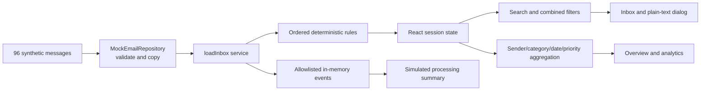
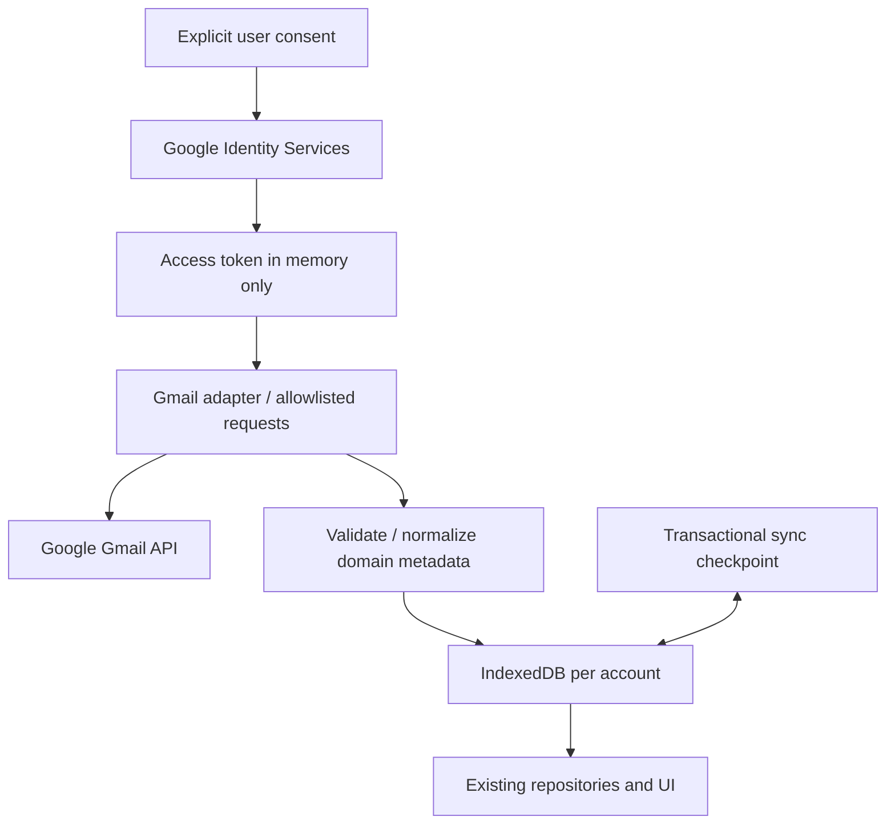

# Architecture

## Implemented browser boundary

The static Vite bundle contains synthetic fixtures, domain models, repository adapter, deterministic rules, event instrumentation and React presentation. The only server in development is Vite serving assets. No application backend, OAuth, remote telemetry, browser database or Gmail network requests exist.

## Responsibilities and flow

`domain/models.ts` defines the provider-independent contract and planned sync/correction types. Repository boundary validation rejects malformed or duplicate messages before rendering. `loadInbox` coordinates one job, classifies each message, records simulated retrieval policy decisions and generic failure events. `selectMessages` composes filters; `summarize` calculates totals from the entire loaded set. App state owns navigation, filters, selected detail and load status. The dialog uses native modal semantics and text nodes. StatusPanel announces loading, empty and error states.

Each refresh creates a fresh metrics collector. React effect cleanup prevents obsolete jobs updating UI after replacement; it does not cancel an actual network request because none exists. Future adapters need AbortSignal and account-switch cancellation. Current load service intentionally identifies its events as synthetic; do not reuse it unchanged for real Gmail jobs.

## External dependencies

Runtime: React/React DOM, Lucide icons. Build/test: Vite, Tailwind Vite plugin, TypeScript, ESLint, Vitest, Testing Library Playwright and Prettier. All assets are bundled; no font CDN or remote image request. npm dependencies are a supply-chain boundary; known advisories are in SECURITY.md.

## Planned authenticated data flow

The browser is a public client and cannot keep a client secret. Identity and Gmail authorization are distinct; a mailbox token is not a SaaS session. No long-lived token storage is allowed. IndexedDB should hold minimized metadata, profiles, corrections and checkpoint state; sensitive bodies are on-demand with explicit retention controls. See storage ADR.

## Deployment and scaling

Planned: static assets over HTTPS on an owner-approved low-cost host, CSP and security headers, no always-on backend. Client-side navigation currently needs no server routes. Static hosting serves code and must not receive private mailbox events.

Future multi-user operation changes the trust boundary: require application identity, tenant-scoped authorization and keys, encrypted server-side credential custody if offline access is introduced, deletion/retention enforcement, operational monitoring and Google verification review. Do not bolt shared user data onto the current in-memory adapter. Feasibility and cost are unvalidated.
