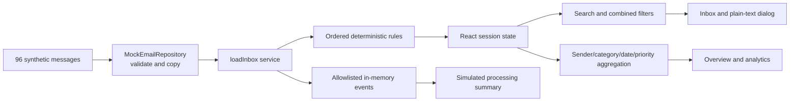
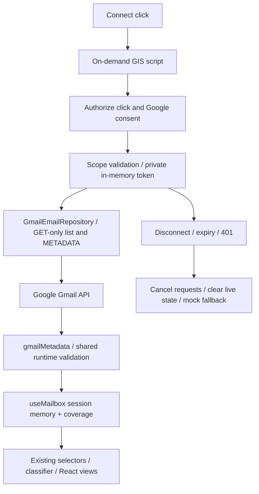

# Architecture

## Implemented browser boundary

The static Vite bundle contains synthetic fixtures, domain models, repository adapter, deterministic rules, event instrumentation and React presentation. The only server in development is Vite serving assets. No application backend, remote telemetry or browser database exists. Phase 2 implements explicit GIS authorization and direct Gmail metadata requests; default mode and all automated verification remain synthetic.

## Responsibilities and flow

`domain/models.ts` defines the provider-independent contract and planned sync/correction types. Shared domain validation and gmailMetadata reject malformed records before rendering; the mock adapter still validates/copies its fixture. `loadInbox` coordinates one job, classifies each message, records simulated retrieval policy decisions and generic failure events. `selectMessages` composes filters; `summarize` calculates totals from the entire loaded set. App owns navigation, filters and selected message ID. useMailbox owns source/session-safe data, progress, load status and coverage. The dialog uses native modal semantics and text nodes. StatusPanel announces loading, empty and error states.

Each refresh creates a fresh metrics collector. React effect cleanup prevents obsolete jobs updating UI after replacement; Gmail operations additionally use AbortController, request timeouts and source/session keys. Disconnect/expiration invalidates visible data immediately, clears retained mailbox results and aborts obsolete work. loadInbox labels runs as synthetic or real and records deeper-fetch simulation only for synthetic data.

## External dependencies

Runtime: React/React DOM, Lucide icons. Build/test: Vite, Tailwind Vite plugin, TypeScript, ESLint, Vitest, Testing Library Playwright and Prettier. Application assets are bundled; no font CDN or remote email image is requested. GIS is the only dynamically loaded third-party script and loads only after Connect. npm dependencies are a supply-chain boundary; known advisories are in SECURITY.md.

## Implemented Phase 2 authorized data flow

The browser is a public client and cannot keep a client secret. Identity and Gmail authorization are distinct; a mailbox token is not a SaaS session. No long-lived token storage is allowed. In future phases IndexedDB should hold minimized metadata, profiles, corrections and checkpoint state; sensitive bodies are on-demand with explicit retention controls. See storage ADR.

## Deployment and scaling

Planned: static assets over HTTPS on an owner-approved low-cost host, CSP and security headers, no always-on backend. Client-side navigation currently needs no server routes. Static hosting serves code and must not receive private mailbox events.

Future multi-user operation changes the trust boundary: require application identity, tenant-scoped authorization and keys, encrypted server-side credential custody if offline access is introduced, deletion/retention enforcement, operational monitoring and Google verification review. Do not bolt shared user data onto the current in-memory adapter. Feasibility and cost are unvalidated.

## Phase 2 adapter and state contracts

GmailEmailRepository implements EmailRepository.list(), exposes content-free coverage/progress, follows list pagination for at most 100 unique IDs, and performs at most four concurrent metadata GETs. The request origin/path are fixed; credentials/referrers/cache are suppressed and redirects refused. Each request has a 15-second deadline. 429/5xx retry up to three attempts with bounded jitter and Retry-After; long waits, 401/403 and network failures stop safely. Malformed/failed individual metadata records can yield a labeled partial sample. No snippet/body/attachment or mailbox write endpoint exists.

Google's list guide documents newest-first results. The adapter additionally sorts successful metadata by internalDate. There is no mailbox snapshot transaction: changes during pagination may affect the sample. Unique IDs deduplicate results; durable checkpoints/history/reconciliation remain later work. Spam/Trash are explicitly excluded, and even an exhausted small listing is described as partial coverage of the mailbox.

GmailAuthorization exposes only safe status snapshots to React. Its token never enters hook state or metrics. Versioned snapshots via useSyncExternalStore let useMailbox switch sources safely; selected details store only a message ID plus source key. Refresh reuses the current valid token without opening OAuth automatically. The SDK itself is a new trust boundary; private fields are not protection from same-origin compromise. No additional npm dependency was needed.

## Aggregate measurement boundary

GmailEmailRepository now counts actual fetch invocations by list/metadata operation and actual retries. useMailbox measures the load/classification duration with a monotonic clock and passes numeric summaries to GmailDiagnostics. Per-run data is session-only, replaced on refresh and cleared on disconnect. A retained-live-result count provides privacy-safe state-clearing evidence; no private data/debug/token accessor is exposed. The live owner-run measurement record is separate from fixture metrics and automated test durations.
