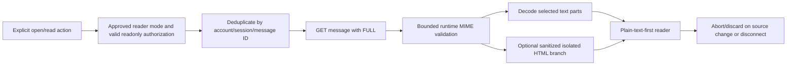

# Full-message reader — separate follow-up design, not implemented

Reviewed 2026-11-03. **The current adapter still requests METADATA only.** The new side pane renders already-loaded synthetic text or the existing live metadata notice. No FULL/thread/attachment request, HTML renderer, sanitizer dependency or body cache was added.

## Verified API boundary

[users.messages.get](https://developers.google.com/workspace/gmail/api/reference/rest/v1/users.messages/get) accepts a format. [FULL](https://developers.google.com/workspace/gmail/api/reference/rest/v1/Format) exposes a parsed payload; RAW instead exposes encoded whole-message data. The existing gmail.readonly permission can support full reading in a future approved milestone; gmail.metadata cannot authorize FULL. A broader OAuth scope is not needed, but expanded content access is still a separate product/privacy decision.

The [Message resource](https://developers.google.com/workspace/gmail/api/reference/rest/v1/users.messages) exposes a recursive MessagePart structure with MIME type, headers, body and child parts. Proposed domain adapters must validate provider data before UI use, rather than expose arbitrary JSON or executable HTML.

## Proposed on-demand data flow

Proposed `MessageContentRepository.getContent(messageId, signal)` returns a bounded domain result separate from the existing metadata repository. Scope/cache ownership includes account + authorization generation + message ID; do not reuse a token/account-agnostic cache. Opening a row should show the metadata shell immediately, load content only on explicit intent, cancel stale results and preserve search/list position. Repeated opens in the same authorized session can deduplicate in-flight work and reuse a bounded memory result after the user approves this behavior. Never prefetch every full message because a pane is enabled. Retrieval depth changes, not discovery coverage.

## MIME decoding and selection policy

Proposed implementation rules, to be verified with synthetic fixtures before shipping:

1. Enforce limits before and during processing: initial proposal 5 MiB decoded text, nesting depth 20, 500 parts, per-header and total-input bounds; measured compatibility review may adjust them. Fail visibly instead of silently truncating a message presented as complete.
2. Decode Gmail's base64url transport representation to bytes with padding/invalid-character checks; decode text using declared charset with a documented fallback and replacement/error disclosure. Do not treat Unicode as Latin-1 or blindly double-decode transfer encodings. Verify actual API fixtures against Gmail's normalized parts; RAW parsing would require a separate standards-compliant MIME parser.
3. Traverse nested `multipart/mixed`, `multipart/alternative` and `multipart/related`. Select a suitable plain-text alternative where available, not a concatenation of duplicate alternatives. Preserve meaningful text-part order and boundaries; do not mislabel attached `.eml` or filename/disposition parts as the main body.
4. Container bodies may be empty; [MessagePartBody](https://developers.google.com/workspace/gmail/api/reference/rest/v1/users.messages.attachments) can contain base64url data or an out-of-line attachmentId/size. A legitimate text body may itself be out-of-line. An approved follow-up must distinguish a bounded selected text-body part from a file download; if its retrieval is not approved/supported, disclose unavailable content rather than call it an empty message. Do not recursively fetch every referenced part. Unsupported charsets, encrypted/signed-only contents and malformed MIME produce a clear unsupported/partial-content state, not fabricated text.
5. Headers are untrusted sender data. Use tested address/header decoding for encoded words and international text; display subject/from/reply-to without treating them as authentication evidence.

Standards: [RFC 2045](https://www.rfc-editor.org/rfc/rfc2045) covers MIME encodings/charset concepts; [RFC 2046](https://www.rfc-editor.org/rfc/rfc2046) defines multipart/media structure. These sources inform the design; no MIME parser is implemented in this milestone.

## Safe content rendering

Plain text remains the first deliverable: React text nodes, readable wrapping and an explicit indication that formatting is omitted. HTML is a separately reviewed option, not the first reader implementation. Following [OWASP XSS guidance](https://cheatsheetseries.owasp.org/cheatsheets/Cross_Site_Scripting_Prevention_Cheat_Sheet.html), use a maintained, pinned allowlist sanitizer with adversarial tests if HTML is later approved. Sanitization must happen before insertion and before browser parsing can initiate unwanted loads; do not insert raw mail into the parent DOM.

Proposed HTML isolation: sandboxed iframe without scripts, forms, same-origin privileges, top navigation or automatic downloads; restrictive per-document CSP denying network/resources by default. Strip scripts, handlers, active elements, form controls, embeds, CSS URL/import/font sources and unsafe protocols. Preserve a safe accessible reading order. Keep sanitizer updated; sandbox and sanitization complement rather than replace one another. Do not promise that either defeats a compromised host origin.

Remote images and tracking pixels stay blocked. Do not load CSS backgrounds, srcset, remote fonts or cid images automatically; cid parts are attachments and may be sensitive/large. Any future remote-content toggle needs an explicit tracking warning and separate threat review. No proxy service is approved.

For future links, allow only reviewed http/https schemes after URL parsing; show the actual destination/host when link text differs. Reject javascript/data/file and header-injection payloads. Require deliberate activation; external links use noopener/noreferrer and a no-referrer policy. Link warnings cannot authenticate senders or guarantee destinations. Do not auto-open links, unsubscribe URLs or model-produced URLs.

## Threads and attachments

Gmail's [thread guide](https://developers.google.com/workspace/gmail/api/guides/threads) and [threads.get](https://developers.google.com/workspace/gmail/api/reference/rest/v1/users.threads/get) support provider conversation retrieval. Future metadata model must retain validated threadId; current messages are individual records and are **not** grouped by subject. Requesting a full thread expands the read set beyond a 100-message sample: disclose loaded/total thread coverage and require deliberate thread expansion. Chronological display should preserve original messages, collapse quoted duplicates only with an accessible expansion control and cite specific source message IDs privately.

[attachments.get](https://developers.google.com/workspace/gmail/api/reference/rest/v1/users.messages.attachments/get) is a separate authorized retrieval path. Initial reader follow-up should omit separate attachment downloads and list only safe metadata if approved. FULL may include inline file-part bytes in its payload; no separate attachment call does not guarantee zero attachment bytes. Design field/size limits and discard non-body parts, with accurate disclosure. Later: explicit per-file action, filename/size/type validation, no automatic execution/inline preview, object-URL cleanup and warnings that download/scanning is not guaranteed safe. No attachment path exists now.

## Retention, errors and acceptance

No IndexedDB/localStorage bodies, raw MIME, sender content, URLs, tokens or thread IDs. Proposed content cache is session-only, bounded and cleared/aborted with source changes, expiry and disconnect; JavaScript memory is not secure erasure. A durable cache/export requires a separate account-isolation/retention/deletion decision. Diagnostics contain aggregate duration/byte counts and error codes only, never message content or identifiers.

States: metadata shell → indeterminate body loading → plain-text content; distinct empty body, unsupported encoding, safe partial/oversized content, removed message (404), auth expiry (401), denied/rate (403/429), network/5xx and cancellation. Retry must be user-controlled/bounded, not a loop that reopens authorization. Preserve current safe mock fallback and ignored-stale-result controls.

Exit gate for a **separate approved reader milestone**: synthetic MIME fixtures (nested alternatives, empty/invalid base64url, UTF-8/legacy charset, oversized/deep trees, inline/attachment parts, hostile HTML/URLs), account/source race tests, no remote requests, memory-only retention, keyboard/mobile reader and unchanged read-only/no-write assertions. Then request approval for any manual real-mail body test. No such test or implementation is authorized here.
